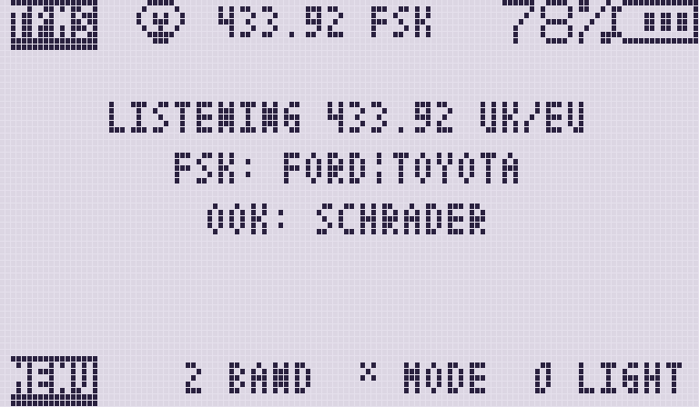
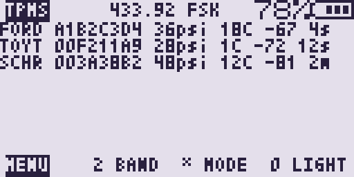
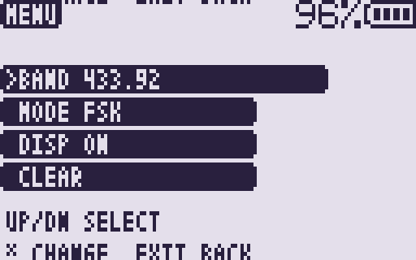

# TPMS RX

[](https://github.com/swooningfish/uv-k1-k5v3_tpmsrx/actions/workflows/build.yml)

Receive-only apps for the
[F4HWN firmware](https://github.com/armel/uv-k1-k5v3-firmware-custom) on the
Quansheng UV-K1 and UV-K5 V3. Each app shows a live list of tyre-pressure
sensors: model, id, pressure, temperature, signal, and how long ago the sensor
was heard. There is no packet history, and the radio never transmits.

Pick the app for the country the car was sold in. The United Kingdom and
Europe share an app. The United States and Canada share another.

## Which app

| App | Where | Default band | Default mode | Cars | Signal |
|---|---|---|---|---|---|
| `TPMS EU` | UK and Europe | 433.92 MHz | FSK | Ford, Toyota, Schrader MRXGG4 | FSK and OOK |
| `TPMS NA` | United States and Canada | 315 MHz | FSK | Ford, Toyota, Schrader MRXGG4 | FSK and OOK |
| `TPMS EU2` | UK and Europe | 433.92 MHz (fixed) | OOK (fixed) | Vauxhall, Opel, Saab; BMW and Mini with the Schrader sensor | OOK |
| `TPMS NA2` | United States and Canada | 315 MHz | OOK (fixed) | Chevrolet and other GM; Subaru; Nissan and Infiniti | OOK |

### Defaults and what you can change

Each app loads its regional default band and demod on first install. Changes
you make are remembered, except where a setting is fixed because every sensor
in that app uses the same value.

| App | Band (`2` / menu) | Mode (`*` / menu) |
|---|---|---|
| `TPMS EU` | Starts 433.92; toggle 315 / 433.92; remembered | Starts FSK; cycle FSK / OOK / AUTO; remembered |
| `TPMS NA` | Starts 315; toggle 315 / 433.92; remembered | Starts FSK; cycle FSK / OOK / AUTO; remembered |
| `TPMS EU2` | Fixed 433.92; no band control | Fixed OOK; no mode control |
| `TPMS NA2` | Starts 315; toggle 315 / 433.92; remembered | Fixed OOK; no mode control |

`TPMS EU` and `TPMS NA` listen for the same three sensors. The only first-launch
difference is the default frequency (433.92 vs 315).

`TPMS EU2` locks both band and mode: Vauxhall, Opel, Saab, BMW, and Mini on
that app are all 433.92 MHz OOK. `TPMS NA2` locks mode to OOK (Chevrolet/GM,
Subaru, Nissan) but still lets you change band, defaulting to 315 MHz.

Newer BMW and Mini sensors that use FSK are not decoded. `TPMS EU2` covers
the older Schrader sensor (often called MRXBC5A4 or MRXBMW433), including the
Mini models that use that same sensor.

On `TPMS NA2`, Subaru and Nissan send the same kind of packet. The pressure
on screen is the Nissan reading. A Subaru sensor reads about a quarter high.
Chevrolet and GM use a different sensor, shown as `EG53`, and that pressure
is not affected.

If `TPMS EU` or `TPMS NA` stays on Listening, try the second app for that region.

## What every app does

- Up to seven live rows. A repeat of the same sensor updates its row.
- Band: 315.00 or 433.92 MHz, except `TPMS EU2`, which is fixed at 433.92 MHz.
- Demod: FSK, OOK, or AUTO on `TPMS EU` and `TPMS NA`. AUTO listens to each
  for about 2.5 seconds, and holds the one that just decoded for 10 seconds.
  `TPMS EU2` and `TPMS NA2` are OOK only (no mode control).
- Options menu (`MENU`). The backlight stays on for 10 seconds after the last
  key, or stays off. The list stays on the screen.
- Receive only.

## Requirements

- A Quansheng UV-K1 or UV-K5 V3 with F4HWN Labs or Fusion that includes
  overlay apps (API level 3 or higher; tested against the v6.3.0 SDK headers).
- Install with UV Studio into a free app slot. The four apps can be installed
  together.

## Install

1. Download the zip for the app in the table from the
   [Releases](https://github.com/swooningfish/uv-k1-k5v3_tpmsrx/releases) page
   and unzip it. GitHub rejects a `.app` upload, so each release file is a
   zip: `TPMSEU.zip`, `TPMSNA.zip`, `TPMSEU2.zip`, `TPMSNA2.zip`. A
   [workflow artifact](https://github.com/swooningfish/uv-k1-k5v3_tpmsrx/actions)
   is the raw `.app`.
2. Open [UV Studio Apps](https://armel.github.io/uvstudio/#apps), connect the
   radio (F4HWN Labs), and install the `.app` from a local file into a free
   slot.
3. On the radio, open the Apps menu (`F` then `7`), select the app name from
   the table, and press `MENU`.

## UV Studio

On F4HWN Labs, load and manage overlay apps in the browser at
[UV Studio Apps](https://armel.github.io/uvstudio/#apps).

## Keys

| Key | Action |
|---|---|
| `MENU` | Open the options menu. Inside the menu, cycle the selected item |
| `2` | Toggle 315.00 / 433.92 MHz. No effect in `TPMS EU2` |
| `*` | Cycle demod: FSK, OOK, AUTO. No effect in `TPMS EU2` or `TPMS NA2` |
| `0` | Turn the backlight off. The screen stays drawn. Any key lights it again for 10 seconds. `EXIT` still quits |
| `EXIT` | Quit (from the listen screen) or close the menu |

### Options menu

| Item | Values |
|---|---|
| `BAND` | `315.00` / `433.92`. Not shown in `TPMS EU2` |
| `MODE` | `FSK` / `OOK` / `AUTO`. Not shown in `TPMS EU2` or `TPMS NA2` |
| `CLEAR` | Wipe the seven live rows |

`TPMS EU2` lists `CLEAR` only (fixed 433.92 OOK). `TPMS NA2` lists `BAND` and
`CLEAR` (OOK fixed; band still changeable, default 315). `TPMS EU` and
`TPMS NA` list all three items.

`UP` / `DOWN` (on the UV-K1, the navigation keys) move the selection. `MENU`,
`*`, `2`, or `5` change the item. `EXIT` closes the menu.

A valid decode blinks the green LED, including while the backlight is off.

## Screen

The status line shows `TPMS` (or `MENU`) on the left, and the band and demod
just left of the battery.

While no sensors have been heard, the screen shows the car types for that
flavour, the demod each group needs (`FSK` or `OOK`), and the region.







| Mode setting | Status text |
|---|---|
| FSK | `433.92 FSK` |
| OOK | `433.92 OOK` |
| AUTO on FSK | `433.92 A:F` |
| AUTO on OOK | `433.92 A:O` |

The list uses the tiny font. A row looks like this:

```
FORD A1B2C3D4 36psi 18C -67 4s
TOYT 00F211A9 28psi 1C -72 12s
SCHR 003A38B2 48psi 12C -81 2m
```

`EG53` and `BMW` use the same layout. Nissan and Infiniti show as `NISS` and
have no temperature. The number after the signal is the age: seconds, then
minutes, then hours.

## How a reading is checked

The field layouts follow [`rtl_433`](https://github.com/merbanan/rtl_433).
Pressure on screen is whole PSI. Temperature is whole degrees Celsius.

- **Ford** (`TPMS EU`, `TPMS NA`). FSK. The air preamble is `55 56`, which is
  `AA A9` after the bits are flipped. Manchester decoding yields 8 bytes. The
  sum of bytes 0 to 6 must equal byte 7. Pressure is the PSI byte times 4,
  and flag bit `0x20` is a ninth pressure bit. Temperature is
  `(byte & 0x7f) - 56` when bit `0x80` is clear.
- **Toyota** (`TPMS EU`, `TPMS NA`). FSK. A 12-bit preamble `A9E`, then
  differential Manchester to 9 bytes. CRC-8, polynomial `0x07`, initial value
  `0x80`. The pressure bytes must match a check byte. PSI is
  `raw × 0.25 − 7`. Temperature is `raw − 40`.
- **Schrader MRXGG4** (`TPMS EU`, `TPMS NA`). OOK Manchester, 68 bits. Drop
  the sync nibble. CRC-8, polynomial `0x07`, initial value `0xF0`. Pressure
  is `byte × 2.5` kPa. Temperature is `byte − 50`.
- **Schrader EG53MA4** (`TPMS EU2` for Vauxhall, Opel, and Saab; `TPMS NA2`
  for Chevrolet and other GM). OOK Manchester, 120 bits. Drop the first 40.
  The checksum is the sum of the next 9 bytes. Pressure uses the same
  `byte × 2.5` kPa scale. The packet stores Fahrenheit; the screen shows
  Celsius.
- **Schrader MRXBC5A4** (`TPMS EU2`, BMW and Mini). OOK Manchester, 61 bits,
  opening with 16 bits of `0111 1111 1111 1111`. The id is 24 bits. Pressure
  is 1 kPa per step. Temperature is the byte minus 50, and a reading is kept
  only when pressure is at most 450 kPa and temperature is between −40 °C and
  85 °C. The two check bits are weak on their own, so those limits are part
  of the check.
- **Nissan NIS315G3 and Subaru SMD3MA4** (`TPMS NA2`). OOK PCM, then
  Manchester. Nissan, Infiniti, and the related Redi-Sensor use one pressure
  scale. Subaru uses another, and the two cannot be told apart from the
  packet. The row is labelled `NISS` and uses the Nissan scale (PSI is the
  raw value divided by 4). There is no temperature. A Subaru tyre reads about
  a quarter higher than it is.

## How it works

```
FSK:  RF -> BK4829 raw AF, wide IF, AFC off -> PA4 at 38.4 kHz
          -> slicer -> PCM bits -> Manchester or differential Manchester
          -> checksum -> row

OOK:  RF -> BK4829 AM -> PA4 at 38.4 kHz
          -> slicer -> Manchester bits -> checksum -> row

NA2:  the same OOK path, then a second Manchester pass for Nissan and Subaru
```

The app writes 315.000 or 433.920 MHz into the receiver and turns the UHF
antenna path on when that switch can be read back. Leaving the app restores
the channel you were on before.

## Build

Docker writes the four apps into `build/`. The image is built on first use.

```sh
./build-docker.sh
```

One flavour at a time: `./build.sh eu`, `na`, `eu2`, or `na2`.

With `arm-none-eabi-gcc`, Python 3, and bash already installed:

```sh
python3 tools/fetch_sdk.py   # downloads the F4HWN app SDK into sdk/
./build.sh                   # writes build/TPMSEU.app and the other three
```

Set `PYTHON` if your Python 3 is not called `python3`, for example
`PYTHON=python ./build.sh`.

Host parser tests (no radio) run at the end of `build-docker.sh`. On their own:

```sh
./test/run_tests.sh
```

Screen pictures in `docs/` are drawn by `python3 tools/mock_lcd.py`.

## License

Apache License 2.0, see [LICENSE](LICENSE) and [NOTICE](NOTICE).
