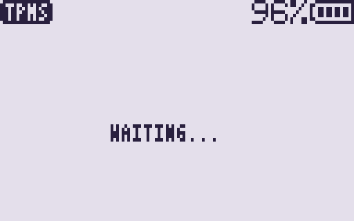

# TPMS RX

[](https://github.com/swooningfish/uv-k1-k5v3_tpmsrx/actions/workflows/build.yml)

A receive-only overlay app for the
[F4HWN firmware](https://github.com/armel/uv-k1-k5v3-firmware-custom) that
decodes common tyre-pressure (TPMS) sensors on the Quansheng UV-K1 and UV-K5 V3.

It shows a live sensor list in the style of the
[sdr-web-gui Sensors table](https://github.com/swooningfish/sdr-web-gui):
model, id, pressure, temperature, RSSI, and age. There is no packet history.

## Features

- **Ford** FSK Manchester, **Toyota** FSK differential Manchester, **Schrader
  MRXGG4** OOK Manchester (rtl_433 layouts).
- Up to seven live rows keyed by `(model, id)`; a repeat id updates its row.
- Band: **315.00** or **433.92** MHz.
- Demod: **FSK**, **OOK**, or **AUTO** (dwells ~2.5 s each; a decode holds the
  path for 10 s).
- Options menu (`MENU`). The backlight stays on for 10 seconds after the last key, or stays off. The sensor list remains on screen.
- Receive only: the app never transmits.

## Requirements

- A Quansheng UV-K1 or UV-K5 V3 with F4HWN Labs / Fusion that includes overlay
  apps (API level 3 or higher; tested against the v6.3.0 SDK headers).
- Install via UV Studio into a free app slot.

## Install

1. Download `TPMSRX.zip` from the
   [Releases](https://github.com/swooningfish/uv-k1-k5v3_tpmsrx/releases) page
   and unzip it. GitHub rejects a `.app` upload. A
   [workflow artifact](https://github.com/swooningfish/uv-k1-k5v3_tpmsrx/actions)
   is the raw `TPMSRX.app`.
2. In UV Studio, open Apps, connect the radio and install `TPMSRX.app` from a
   local file.
3. On the radio, open the Apps menu (`F` then `7`), select **TPMS RX** and press
   `MENU`.

## Keys

| Key | Action |
|---|---|
| `MENU` | Open the options menu. Inside the menu, cycle the selected item |
| `2` | Toggle 315.00 / 433.92 MHz |
| `*` | Cycle demod: FSK → OOK → AUTO |
| `0` | Turn the backlight off. The screen stays drawn. Any key lights it again for 10 seconds. `EXIT` still quits |
| `EXIT` | Quit (from the listen screen) or close the menu |

### Options menu

| Item | Values |
|---|---|
| `BAND` | `315.00` / `433.92` |
| `MODE` | `FSK` / `OOK` / `AUTO` |
| `CLEAR` | Wipe the seven live rows |

`UP` / `DOWN` (UV-K1: nav) move the selection. `MENU`, `*`, `2`, or `5` change the item. `EXIT` closes the menu.
A valid decode blinks the green LED twice (also while the backlight is off).

## Screen

Status bar: title `TPMS` (or `MENU`) on the left, band and mode just left of the battery.




| Mode setting | Status text |
|---|---|
| FSK | `433.92 FSK` |
| OOK | `433.92 OOK` |
| AUTO on FSK dwell | `433.92 A:F` |
| AUTO on OOK dwell | `433.92 A:O` |

Body (tiny font):

```
FORD A1B2C3D4 36psi 18C -67 4s
TOYT 00F211A9 28psi 1C -72 12s
SCHR 003A38B2 48psi 12C -81 2m
```

## Supported frames

Layouts follow [`rtl_433`](https://github.com/merbanan/rtl_433):

- **Ford** — inverted FSK PCM, preamble `AA A9`, Manchester to 8 bytes; sum of
  bytes 0..6 must equal byte 7. Pressure is PSI×4 (flags bit `0x20` is the 9th
  bit). Temperature is `(byte & 0x7f) - 56` when bit `0x80` is clear.
- **Toyota** — FSK PCM, 12-bit preamble `A9E`, differential Manchester to 9
  bytes; CRC-8 poly `0x07` init `0x80`. Pressure raw must match the inverted
  check byte; PSI = raw×0.25 − 7. Temperature is raw − 40.
- **Schrader MRXGG4** — OOK Manchester, 68 bits; drop the sync nibble; CRC-8
  poly `0x07` init `0xF0`. Pressure is `byte × 2.5` kPa, shown as PSI.
  Temperature is `byte − 50`.

Not in this version: Schrader EG53MA4, SMD3MA4, NIS315G3, BMW MRXBC5A4, and
other `rtl_433` TPMS families.

## How it works

```
FSK:  RF -> BK4829 RAW, wide IF, AFC off -> AF bypass -> PA4 @ 38.4 kHz
          -> hysteresis slicer -> PCM bits -> Manchester / diff-Manchester
          -> checksum / CRC -> row

OOK:  RF -> BK4829 AM AF -> PA4 @ 38.4 kHz
          -> hysteresis slicer -> Manchester bits -> CRC-8 -> row
```

## Build

Docker writes `build/TPMSRX.app`. The image is built on first use.

```sh
./build-docker.sh
```

With `arm-none-eabi-gcc`, Python 3 and bash already installed:

```sh
python3 tools/fetch_sdk.py   # downloads the F4HWN app SDK into sdk/
./build.sh                   # writes build/TPMSRX.app
```

Set `PYTHON` if your Python 3 is not called `python3`, for example
`PYTHON=python ./build.sh`.

Host parser tests (no radio) run at the end of `build-docker.sh`. On their own:

```sh
./test/run_tests.sh
```

## License

Apache License 2.0, see [LICENSE](LICENSE) and [NOTICE](NOTICE).
