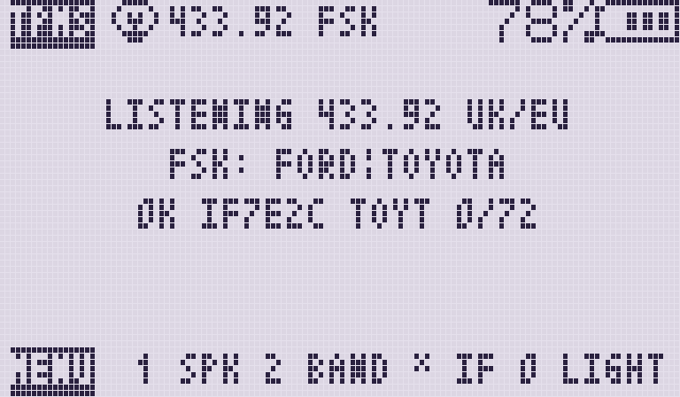

# TPMS RX

[](https://github.com/swooningfish/uv-k1-k5v3_tpmsrx/actions/workflows/build.yml)

Receive-only tyre-pressure (TPMS) apps for the
[F4HWN firmware](https://github.com/armel/uv-k1-k5v3-firmware-custom) on the
Quansheng UV-K1 and UV-K5 V3. Each app shows a live list of the sensors it
hears: model, id, pressure, temperature, signal strength, and how long ago
each one was heard. The radio never transmits.



> **Safety disclaimer.** These apps are hobby tools, not a certified tyre
> pressure monitor. A reading can be wrong, out of date, or from another
> car's sensor. Do not rely on them to decide whether a vehicle is safe to
> drive. Always check tyre pressures with a calibrated gauge. The driver is
> solely responsible for the condition and pressures of their tyres; the
> authors accept no liability for any loss, damage or injury from using
> these apps. See also the "AS IS" terms of the [LICENSE](LICENSE).

## Which app

Pick the app for the region the car was sold in and the type of sensor it
uses. If you are not sure, install both apps for your region.

| App | Region | Band | Demod | Sensors |
|---|---|---|---|---|
| `TPMS EU` | UK and Europe | 433.92 MHz (can switch to 315) | FSK | Ford, Toyota |
| `TPMS NA` | United States and Canada | 315 MHz (can switch to 433.92) | FSK | Ford, Toyota |
| `TPMS EU2` | UK and Europe | 433.92 MHz, fixed | OOK | Schrader MRXGG4; Vauxhall, Opel, Saab; BMW and Mini (older Schrader sensor) |
| `TPMS NA2` | United States and Canada | 315 MHz, fixed | OOK | Schrader MRXGG4; Chevrolet and other GM; Subaru; Nissan and Infiniti |
| `TPMS DBG` | Either | 433.92 MHz (can switch) | FSK or OOK | No decoding: records raw bursts to find out why a list app hears nothing |

- `TPMS EU` and `TPMS NA` are the same app with a different starting band.
  A band you change is remembered.
- **Upgrading from before v1.3.0?** Schrader MRXGG4 moved from `TPMS EU` /
  `TPMS NA` to `TPMS EU2` / `TPMS NA2`, and the AUTO mode is gone. Each app
  now has one demod.
- BMW and Mini: only the older Schrader sensor (often sold as MRXBC5A4 or
  MRXBMW433) is decoded. Newer FSK sensors are not.
- Subaru and Nissan send the same kind of packet and cannot be told apart.
  Both show as `NISS` on the Nissan pressure scale, so **a Subaru tyre reads
  about a quarter higher than it really is**. Chevrolet and GM use a
  different sensor (`EG53`) and read correctly.

All five apps build from the same sources (`tpmsrx_app.c`, `dectpms.c`, and
`tpmsdbg_app.c` for `TPMS DBG`) with a flavour flag, so there are no separate
regional code trees.

## Install

You need a UV-K1 or UV-K5 V3 running F4HWN Labs or Fusion with overlay apps
(app API level 3 or higher; tested against the v6.3.0 SDK). The apps can be
installed side by side, one per free slot.

1. Download the zip for your app from the
   [Releases](https://github.com/swooningfish/uv-k1-k5v3_tpmsrx/releases)
   page (`TPMSEU.zip`, `TPMSNA.zip`, `TPMSEU2.zip`, `TPMSNA2.zip`,
   `TPMSDBG.zip`) and unzip it to get the `.app` file. Releases are zipped
   because GitHub rejects `.app` uploads. Each
   [build workflow run](https://github.com/swooningfish/uv-k1-k5v3_tpmsrx/actions)
   also has the raw `.app` files as artifacts.
2. Open [UV Studio Apps](https://armel.github.io/uvstudio/#apps) in your
   browser, connect the radio, and install the `.app` from a local file into a
   free slot.
3. On the radio, open the Apps menu (`F` then `7`), select the app, and press
   `MENU`.

## Using the app

### Safety warning

The listening screen, shown at every launch until a sensor is heard, ends
with `PSI MAY BE WRONG: CHECK GAUGE` and `DRIVER IS RESPONSIBLE`. See the
safety disclaimer at the top of this page.

### Keys

| Key | Action |
|---|---|
| `MENU` | Open the options menu |
| `1` | Speaker on or off. A speaker icon shows on the status line while it is on |
| `2` | Switch between 315.00 and 433.92 MHz (`TPMS EU` and `TPMS NA` only) |
| `*` | Next IF / demod preset (`TPMS EU` and `TPMS NA` only). See [Toyota test settings](#toyota-test-settings) |
| `UP` / `DOWN` | Move the tuning 5 kHz up or down (`TPMS EU` and `TPMS NA` only; the navigation keys on the UV-K1). See [Toyota test settings](#toyota-test-settings) |
| `0` | Force backlight on or off. While forced, the screen stays lit and a light bulb shows on the status line. Off goes back to lighting the screen for 10 seconds after each key. Saved on exit |
| `EXIT` | Quit, or close the menu. Once the screen has gone dark, the first press only lights it |

With the speaker on you hear what the decoder hears. Hiss means the receiver
is working, and a short rasp or click is a sensor sending. Silence means the
audio is muted or there is no signal.

A good decode blinks the green LED, even with the backlight off.

### Options menu


| Item | What it does |
|---|---|
| `BAND` | `315.00` / `433.92`. Only in `TPMS EU` and `TPMS NA` |
| `SENS` | Sensitivity: `LOW` / `MID` / `HIGH` (default `MID`). `HIGH` hears weaker, more distant sensors; `LOW` ignores more noise and far-off cars. Saved on exit |
| `CLEAR` | Wipe the list |

`UP` / `DOWN` (the navigation keys on the UV-K1) select an item. `MENU`, `2`
or `5` change it. `EXIT` closes the menu. The menu also shows the app version.
Decoding pauses while the menu is open, so a sensor that sends then is missed.

### The screen

The status line shows, from left to right:

- `TPMS` (or `MENU` in the menu).
- A light bulb only while the backlight is forced on with `0`. It starts on
  when the radio's own backlight setting is always on (on firmware that lets
  apps read it); the radio then keeps the screen lit even with the bulb off.
  A key that lights the screen for 10 seconds, such as `1` for the speaker,
  does not show it.
- The band and demod, for example `433.92 FSK` or `315.00 OOK`.
- A speaker icon while the speaker is on. Its space is always reserved, so
  nothing shifts when it appears.
- The battery percent and icon.

Before any sensor is heard, the screen shows `LISTENING <band> <region>` and
the cars that app decodes. `TPMS EU` and `TPMS NA` add the Toyota test line
under the cars (see [Toyota test settings](#toyota-test-settings)). While
there are three or fewer sensors, the free rows show key hints (`1 SPK`,
`2 BAND`, `* IF`, `0 LIGHT`).

The list holds up to seven sensors. A sensor that is heard again updates its
own row.


```
FORD A1B2C3D4 36psi 18C -67 4s
TOYT 00F211A9 28psi 1C -72 12s
```

Each row is: model, id, pressure in whole PSI, temperature in whole °C,
signal in dBm, and age (seconds, then minutes, then hours). Models are
`FORD`, `TOYT`, `SCHR`, `EG53`, `BMW` and `NISS`. `NISS` has no temperature.
The id has as many hex digits as the sensor sends, as rtl_433 prints it: 8 for
`FORD` and `TOYT`, 7 for `SCHR`, and 6 for the rest. A row that would be wider
than the screen, such as `-12C -105 45s`, drops the space after the
temperature (`-12C-105 45s`).

On `TPMS EU2` and `TPMS NA2` the signal is read about 2 ms into the burst,
while the sensor is still sending.

Drawing the screen pauses decoding, so the list only redraws on a key press
or 200 ms after a decode. Ages are as of the last redraw.

The waiting and menu screens for all four list apps are in
[docs/variants.md](docs/variants.md).

### Troubleshooting

If the list stays on `LISTENING`:

1. Wake the sensor: use a TPMS tool, let a little air out, or drive a short
   distance. Most sensors send rarely while parked.
2. Try the other app for your region. `TPMS EU` / `TPMS NA` hear FSK sensors,
   `TPMS EU2` / `TPMS NA2` hear OOK sensors.
3. Turn the speaker on (`1`) and listen for a rasp when the sensor sends.
4. Run `TPMS DBG`. It does not decode, but it shows whether any signal reaches
   the radio and records each raw burst, and its `MENU` wizard suggests what
   to change. See [docs/debug.md](docs/debug.md).

If `TPMS DBG` records bursts but no list app shows the sensor, that sensor
model is probably not supported.

### Toyota test settings

`TPMS EU` and `TPMS NA` have two radio settings for testing Toyota (and Ford)
reception. Both are saved on exit. Changing either one, or the band, retunes
the radio and resets the test line.

Before any sensor is listed, the line under the cars shows them:

```
-5K IF7E2C TOYT 40/72
```

- `-5K` is the tuning offset from 315.00 or 433.92 MHz, in kHz. `UP` / `DOWN`
  move it 5 kHz at a time, from −40 to +35 kHz. One more step wraps to the
  other end. The default is `0K`.
- `IF7E2C` is the BK4819 IF / demod register (`REG_43`). `*` steps through
  four presets:

  | Preset | Meaning |
  |---|---|
  | `7E2C` | Default. 25 kHz mode, normal audio gain after the FM demod |
  | `7E28` | 25 kHz mode, demod gain bit flipped (6 dB step) |
  | `7E0C` | 12.5 kHz mode: more audio per kHz of deviation, but wide FSK clips sooner |
  | `7E08` | 12.5 kHz mode, demod gain bit flipped |

- `TOYT 40/72` is the most bits one Toyota sync has decoded, out of the 72 in a
  frame, since the last retune. Noise alone seldom gets past about 12.

How to read it, with a Toyota sensor woken next to the radio. Every key
below resets the count, so change one setting, wake the sensor two or three
times, then read the count. On the UV-K1, `UP` / `DOWN` are `RIGHT` / `LEFT`.

| `TOYT` count | Meaning | Keys to try, waking the sensor after each |
|---|---|---|
| Stays near 0–12 | No Toyota preamble heard | `2` if the band may be wrong. Then `UP` once (`5K`), `DOWN` twice (`-5K`), `DOWN` once (`-10K`), `UP` three times (`10K`). Back at `0K`, `*` to try each preset |
| Rises to 20–70 | Bursts are heard but break up | `UP` / `DOWN` to find the offset with the highest count. At that offset, `*` to step through `7E28`, `7E0C` and `7E08` |
| Reaches 72, no row | Whole frames decode but fail the CRC | Bit errors near the end, or a sensor that only looks like this Toyota format. At the best preset, `UP` and `DOWN` one step each way |
| A `TOYT` row appears | Working | None. Note the offset and preset on the test line; they are saved on exit |

The test line only shows while the list is empty. If another sensor fills a
row, `MENU` then `CLEAR` brings it back. To return to the defaults, press
`UP` / `DOWN` until the line reads `0K`, then `*` until it reads `7E2C`.

The decoder follows rtl_433's "Toyota TPMS" (Pacific PMV-C210, as in the Auris
and Corolla): 52 µs chips. The Pacific PMV-107J used on many US Toyotas at
315 MHz is a different format (100 µs chips, 66 bits) and is not decoded.

Close any screen capture (UV Studio or K5Viewer over the K-plug) while you
listen. The app sends the viewer a frame every half second, and on the
K-plug each frame takes up to 0.3 s, during which the app hears nothing.
Over USB the frames are short.

## How a reading is checked

The field layouts follow [`rtl_433`](https://github.com/merbanan/rtl_433).
Every packet must pass its checksum before it is shown.

- **Ford** (`TPMS EU`, `TPMS NA`). FSK. Preamble `55 56`, or `AA A9` when the
  signal arrives inverted. Manchester decoding gives 8 bytes, and bytes 0 to 6
  must sum to byte 7. Pressure is a 9-bit value in quarter PSI (flag bit
  `0x20` is the ninth bit). Temperature is `(byte & 0x7f) − 56` °C, and is
  left out when bit `0x80` is set.
- **Toyota** (`TPMS EU`, `TPMS NA`). FSK. 12-bit preamble `A9E` (or `561`
  inverted), then differential Manchester to 9 bytes. CRC-8, polynomial
  `0x07`, initial value `0x80`, and the pressure must match an inverted copy
  of itself. PSI is `raw ÷ 4 − 7`. Temperature is `raw − 40` °C.
- **Schrader EG53MA4** (`TPMS EU2` for Vauxhall, Opel and Saab; `TPMS NA2` for
  Chevrolet and other GM). OOK Manchester, 120 bits; the first 40 are
  dropped. The next 9 bytes must sum to the checksum byte. Pressure is
  `byte × 2.5` kPa. The packet holds Fahrenheit, shown as Celsius.
- **Schrader MRXBC5A4** (`TPMS EU2`, BMW and Mini). OOK Manchester, 61 bits,
  starting with `0111 1111 1111 1111`. 24-bit id. Pressure is 1 kPa per step,
  temperature is `byte − 50` °C. The two check bits are weak, so a reading is
  also rejected above 450 kPa or outside −40 to 85 °C.
- **Nissan NIS315G3 and Subaru SMD3MA4** (`TPMS NA2`). OOK PCM with sync
  `555E`, then Manchester. PSI is `raw ÷ 4` (Nissan scale, see the Subaru note
  under [Which app](#which-app)). No temperature.
- **Schrader MRXGG4** (`TPMS EU2`, `TPMS NA2`). OOK Manchester, 68 bits; the
  sync nibble is dropped. CRC-8, polynomial `0x07`, initial value `0xF0`.
  Pressure is `byte × 2.5` kPa, temperature `byte − 50` °C. It has no sync
  word of its own, so it is tried last.

## How it works

```
FSK:  RF -> BK4829 raw AF, wide IF, AFC off -> PA4 at 38.4 kHz
          -> slicer -> PCM bits -> Manchester or differential Manchester
          -> checksum -> row

OOK:  RF -> BK4829 AM -> PA4 at 38.4 kHz
          -> slicer -> Manchester bits -> checksum -> row

NA2:  the same OOK path, plus a second pass on the raw bits for Nissan and Subaru
```

The app tunes the receiver to 315.000 or 433.920 MHz and switches on the UHF
antenna path where it can read that switch back. Quitting restores the
channel you were on.

## Build

With Docker, this builds all five apps into `build/` and runs the host parser
tests. The image is built on first use.

```sh
./build-docker.sh
```

Without Docker you need `arm-none-eabi-gcc`, Python 3 and bash:

```sh
python3 tools/fetch_sdk.py   # downloads the F4HWN app SDK into sdk/
./build.sh                   # writes build/TPMSEU.app, TPMSNA.app, TPMSEU2.app, TPMSNA2.app, TPMSDBG.app
```

- Build one app: `./build.sh eu`, `na`, `eu2`, `na2` or `dbg`.
- Set `PYTHON` if Python 3 is not called `python3`, for example
  `PYTHON=python ./build.sh`.
- Run the host parser tests (no radio needed): `./test/run_tests.sh`.
- Redraw the screen pictures in `docs/`: `python3 tools/mock_lcd.py`.
- The release version is `APP_VER` in `build.sh`.

Code sizes in v1.3.1 (each app must fit the 4 KB app space): `TPMS EU` 3892 B,
`TPMS NA` 3888 B, `TPMS EU2` 3892 B, `TPMS NA2` 3948 B, `TPMS DBG` 4060 B.

## License

Apache License 2.0, see [LICENSE](LICENSE) and [NOTICE](NOTICE).
