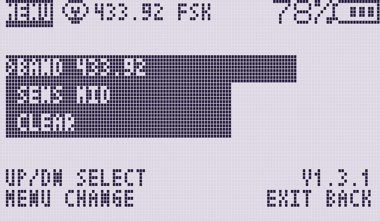
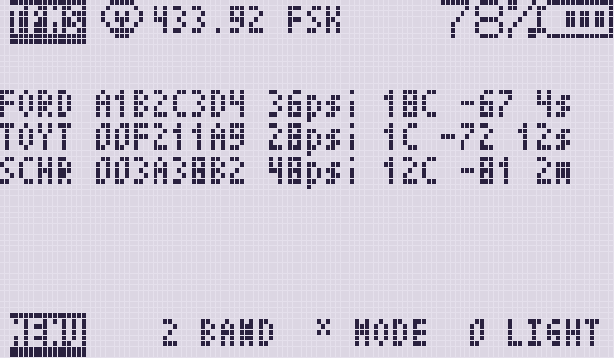

# TPMS RX

[](https://github.com/swooningfish/uv-k1-k5v3_tpmsrx/actions/workflows/build.yml)

Receive-only tyre-pressure (TPMS) apps for the
[F4HWN firmware](https://github.com/armel/uv-k1-k5v3-firmware-custom) on the
Quansheng UV-K1 and UV-K5 V3. Each app shows a live list of the sensors it
hears: model, id, pressure, temperature, signal strength, and how long ago
each one was heard. The radio never transmits.


> **Safety disclaimer.** These apps are hobby tools, not a certified tyre
> pressure monitor. A reading can be wrong, out of date, or from another
> car's sensor. Do not rely on them to decide whether a vehicle is safe to
> drive. Always check tyre pressures with a calibrated gauge. The driver is
> solely responsible for the condition and pressures of their tyres; the
> authors accept no liability for any loss, damage or injury from using
> these apps. See also the "AS IS" terms of the [LICENSE](LICENSE).

## Which app

Pick the app for the region the car was sold in and the type of sensor it
uses. If you are not sure, install both apps for your region.

| App | Region | Band | Demod | Sensors |
|---|---|---|---|---|
| `TPMS EU` | UK and Europe | 433.92 MHz (can switch to 315) | FSK | Ford, Toyota |
| `TPMS NA` | United States and Canada | 315 MHz (can switch to 433.92) | FSK | Ford, Toyota |
| `TPMS EU2` | UK and Europe | 433.92 MHz, fixed | OOK | Schrader MRXGG4; Vauxhall, Opel, Saab; BMW and Mini (older Schrader sensor) |
| `TPMS NA2` | United States and Canada | 315 MHz, fixed | OOK | Schrader MRXGG4; Chevrolet and other GM; Subaru; Nissan and Infiniti |
| `TPMS DBG` | Either | 433.92 MHz (can switch) | FSK or OOK | No decoding: records raw bursts to find out why a list app hears nothing |
| `TPMS CAP` | Either | 433.92 MHz (can switch) | FSK | Streams the sliced audio over the K-plug cable to a PC, where the browser page `tools/kplug.html` decodes Toyota and Ford bursts bit by bit. See [docs/kplug.md](docs/kplug.md) |

- `TPMS EU` and `TPMS NA` are the same app with a different starting band.
  A band you change is remembered.
- **Upgrading from before v1.3.0?** Schrader MRXGG4 moved from `TPMS EU` /
  `TPMS NA` to `TPMS EU2` / `TPMS NA2`, and the AUTO mode is gone. Each app
  now has one demod.
- BMW and Mini: only the older Schrader sensor (often sold as MRXBC5A4 or
  MRXBMW433) is decoded. Newer FSK sensors are not.
- Subaru and Nissan send the same kind of packet and cannot be told apart.
  Both show as `NISS` on the Nissan pressure scale, so **a Subaru tyre reads
  about a quarter higher than it really is**. Chevrolet and GM use a
  different sensor (`EG53`) and read correctly.

All five apps build from the same sources (`tpmsrx_app.c`, `dectpms.c`, and
`tpmsdbg_app.c` for `TPMS DBG`) with a flavour flag, so there are no separate
regional code trees.

## Install

You need a UV-K1 or UV-K5 V3 running F4HWN Labs or Fusion with overlay apps
(app API level 3 or higher; tested against the v6.3.0 SDK). The apps can be
installed side by side, one per free slot.

1. Download the zip for your app from the
   [Releases](https://github.com/swooningfish/uv-k1-k5v3_tpmsrx/releases)
   page (`TPMSEU.zip`, `TPMSNA.zip`, `TPMSEU2.zip`, `TPMSNA2.zip`,
   `TPMSDBG.zip`) and unzip it to get the `.app` file. Releases are zipped
   because GitHub rejects `.app` uploads. Each
   [build workflow run](https://github.com/swooningfish/uv-k1-k5v3_tpmsrx/actions)
   also has the raw `.app` files as artifacts.
2. Open [UV Studio Apps](https://armel.github.io/uvstudio/#apps) in your
   browser, connect the radio, and install the `.app` from a local file into a
   free slot.
3. On the radio, open the Apps menu (`F` then `7`), select the app, and press
   `MENU`.

## Using the app

### Keys

| Key | Action |
|---|---|
| `MENU` | Open the options menu |
| `1` | Speaker on or off. A speaker icon shows on the status line while it is on |
| `2` | Switch between 315.00 and 433.92 MHz (`TPMS EU` and `TPMS NA` only) |
| `*` | Next IF / demod preset (`TPMS EU` and `TPMS NA` only). See [Toyota test settings](docs/toyota.md) |
| `UP` / `DOWN` | Move the tuning 5 kHz up or down (`TPMS EU` and `TPMS NA` only; the navigation keys on the UV-K1). See [Toyota test settings](docs/toyota.md) |
| `0` | Force backlight on or off. While forced, the screen stays lit and a light bulb shows on the status line. Off goes back to lighting the screen for 10 seconds after each key. Saved on exit |
| `EXIT` | Quit, or close the menu. Once the screen has gone dark, the first press only lights it |

With the speaker on you hear what the decoder hears. Hiss means the receiver
is working, and a short rasp or click is a sensor sending. Silence means the
audio is muted or there is no signal.

A good decode blinks the green LED, even with the backlight off.

### Options menu



| Item | What it does |
|---|---|
| `BAND` | `315.00` / `433.92`. Only in `TPMS EU` and `TPMS NA` |
| `SENS` | Sensitivity: `LOW` / `MID` / `HIGH` (default `MID`). `HIGH` hears weaker, more distant sensors; `LOW` ignores more noise and far-off cars. Saved on exit |
| `CLEAR` | Wipe the list |

`UP` / `DOWN` (the navigation keys on the UV-K1) select an item. `MENU`, `2`
or `5` change it. `EXIT` closes the menu. The menu also shows the app version.
Decoding pauses while the menu is open, so a sensor that sends then is missed.

### The screen

The status line shows, from left to right:

- `TPMS` (or `MENU` in the menu).
- A light bulb only while the backlight is forced on with `0`. It starts on
  when the radio's own backlight setting is always on (on firmware that lets
  apps read it); the radio then keeps the screen lit even with the bulb off.
  A key that lights the screen for 10 seconds, such as `1` for the speaker,
  does not show it.
- The band and demod, for example `433.92 FSK` or `315.00 OOK`.
- A speaker icon while the speaker is on. Its space is always reserved, so
  nothing shifts when it appears.
- The battery percent and icon.

Before any sensor is heard, the screen shows `LISTENING <band> <region>` and
the cars that app decodes. `TPMS EU` and `TPMS NA` add the Toyota test line
under the cars (see [Toyota test settings](docs/toyota.md)). While
there are three or fewer sensors, the free rows show key hints (`1 SPK`,
`2 BAND`, `* IF`, `0 LIGHT`).

The list holds up to seven sensors. A sensor that is heard again updates its
own row.



```
FORD A1B2C3D4 36psi 18C -67 4s
TOYT 00F211A9 28psi 1C -72 12s
```

Each row is: model, id, pressure in whole PSI, temperature in whole °C,
signal in dBm, and age (seconds, then minutes, then hours). Models are
`FORD`, `TOYT`, `SCHR`, `EG53`, `BMW` and `NISS`. `NISS` has no temperature.
The id has as many hex digits as the sensor sends, as rtl_433 prints it: 8 for
`FORD` and `TOYT`, 7 for `SCHR`, and 6 for the rest. A row that would be wider
than the screen, such as `-12C -105 45s`, drops the space after the
temperature (`-12C-105 45s`).

On `TPMS EU2` and `TPMS NA2` the signal is read about 2 ms into the burst,
while the sensor is still sending.

Drawing the screen pauses decoding, so the list only redraws on a key press
or 200 ms after a decode. Ages are as of the last redraw.

The waiting and menu screens for all four list apps are in
[docs/variants.md](docs/variants.md).

### Troubleshooting

If the list stays on `LISTENING`:

1. Wake the sensor: use a TPMS tool, let a little air out, or drive a short
   distance. Most sensors send rarely while parked.
2. Try the other app for your region. `TPMS EU` / `TPMS NA` hear FSK sensors,
   `TPMS EU2` / `TPMS NA2` hear OOK sensors.
3. Turn the speaker on (`1`) and listen for a rasp when the sensor sends.
4. Run `TPMS DBG`. It does not decode, but it shows whether any signal reaches
   the radio and records each raw burst, and its `MENU` wizard suggests what
   to change. See [docs/debug.md](docs/debug.md).

If `TPMS DBG` records bursts but no list app shows the sensor, that sensor
model is probably not supported.

## More docs

- [Toyota test settings](docs/toyota.md): the tuning offset, IF presets and
  `TOYT` count in `TPMS EU` / `TPMS NA`, and how to use them.
- [How it works](docs/how-it-works.md): the signal path and how each sensor's
  reading is checked.
- [Build](docs/build.md): building the apps and running the tests.
- [TPMS DBG](docs/debug.md), [TPMS CAP and the K-plug decoder](docs/kplug.md),
  [Variant screens](docs/variants.md).

## License

Apache License 2.0, see [LICENSE](LICENSE) and [NOTICE](NOTICE).
