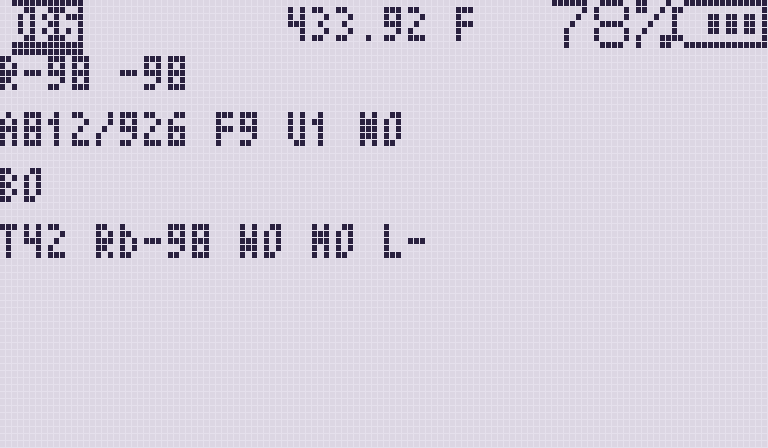
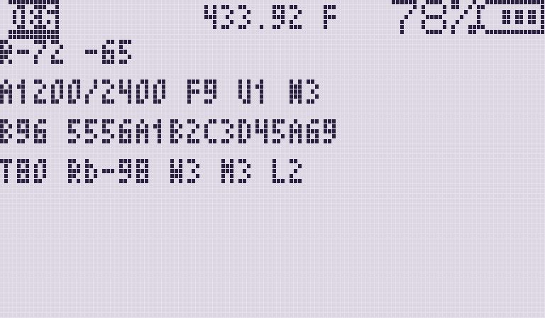
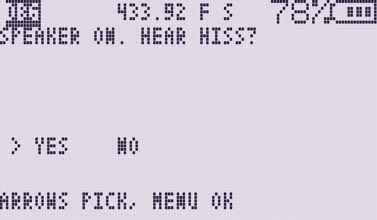
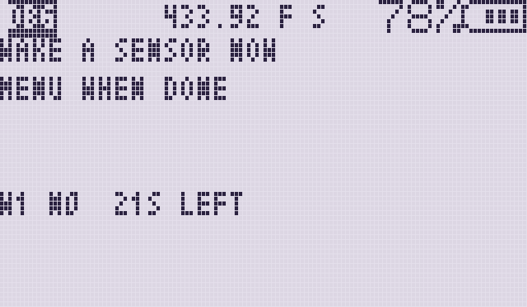
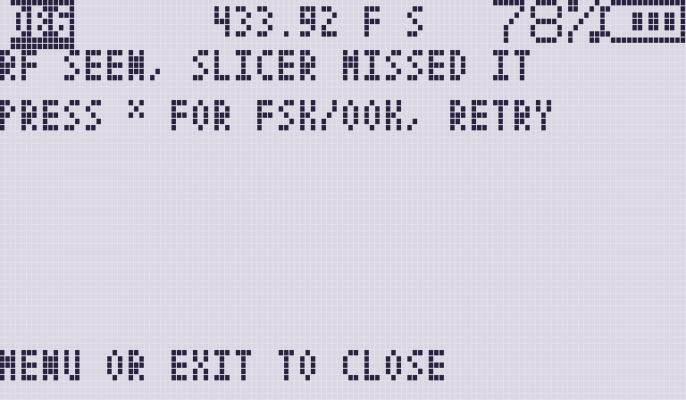

# TPMS DBG

`TPMS DBG` checks the receive path when a list app (`TPMS EU`, `TPMS NA`,
`TPMS EU2`, `TPMS NA2`) stays on Listening. It does not decode sensors. It
parks on the same frequency and uses the same audio route as the list apps,
then records each raw burst: the sliced bits, before Manchester decoding or
checksums.

If DBG records bursts but a list app stays empty, the radio side works and the
problem is decoding. If DBG records nothing, fix the radio side first.

## Install

Install `TPMSDBG.zip` from the
[Releases](https://github.com/swooningfish/uv-k1-k5v3_tpmsrx/releases) page
with [UV Studio](https://armel.github.io/uvstudio/#apps), the same way as the
list apps. To build only this app: `bash ./build.sh dbg`.

## Keys

| Key | Action |
|---|---|
| `MENU` | Open the guided wizard (see below) |
| `1` | Speaker on or off |
| `2` | Toggle 315.00 / 433.92 MHz |
| `*` | Toggle FSK / OOK (`F` / `O` on the status line) |
| `5` | Clear the peaks, the counters, the timer, and the last burst |
| `EXIT` | Quit. Inside the wizard, close the wizard |

## The screen

Idle, waiting for a sensor:

After three bursts:

The status line shows `DBG`, the band, `F` or `O` for the demod, and `S`
while the speaker is on. Under it are four rows:

| Row | Format | Meaning |
|---|---|---|
| 1 | `R<now> <peak>` | Signal strength in dBm now, and the strongest since launch or `5` |
| 2 | `A<now>/<peak> F<n> U<n> N<n>` | Loudest audio sample in the last 20 ms, and the strongest so far. `F` is the audio route: FSK should be `9`, OOK `7`, `0` is muted. `U` is `1` when the UHF antenna path read back. `N` is the number of bursts recorded |
| 3 | `B<bits> <hex>` | Bit count of the last burst, then its first bytes in hex |
| 4 | `T<s> Rb<dBm> W<n> M<n> L<s>` | Seconds since launch or `5`. Idle signal baseline. Wake attempts seen. Bursts recorded within 1 s of a wake attempt. Seconds since the last wake attempt (`-` until the first) |

### Wake attempts (row 4)

For the first 5 seconds the app learns the quiet signal level, `Rb`. After that
`Rb` follows the band slowly. Any reading 10 dB or more above `Rb` counts as one
wake attempt (`W`). A burst recorded within 1 second of one also counts in `M`.

Keep the radio still for the first 5 seconds, or press `5` to relearn `Rb`.

### Example readings

| Situation | Screen | What it means |
|---|---|---|
| Idle, FSK, 433.92, path working | `R-98 -98` / `A812/926 F9 U1 N0` / `B0` / `T42 Rb-98 W0 M0 L-` | Quiet band. Audio is reaching the decoder (`F9`, `A` moving) and the UHF path is set (`U1`). No sensor has sent yet. This is not a squelch or mute fault |
| Good burst | `R-72 -65` / `A1200/2400 F9 U1 N3` / `B96 5556A1B2…` / `T80 Rb-98 W3 M3 L2` | The signal jumped, bursts were recorded, and each matched a wake attempt |
| RF but no burst | `R-80 -70` / `… N0` / `… W2 M0` | A signal arrived but nothing was sliced. Try `*` for the other demod, or `2` for the other band |
| Muted audio | `… F0 …` | The audio route is muted. Quit and relaunch |
| Nothing at all | `R-98 -98` / `… N0` / `… W0` after waking a sensor | No signal reached the radio. Move closer, check the band and the antenna |

## Checklist

Wake a sensor with a TPMS tool, by letting a little air out, or by driving a
short distance, then:

1. Check the status line: `.92` or `.00`, and `F` or `O`.
2. Match the sensor. Ford and Toyota send FSK. Schrader and most GM, Subaru and
   Nissan sensors send OOK. Europe is 433.92, North America is 315.00.
3. Watch row 1 and row 4. `R` should jump, and `W` should go up.
4. Watch `N` and `B`. A TPMS burst is usually 60 to 96 bits or more.
5. Press `1` to listen. Hiss means the receiver is alive. A short rasp is a
   burst.

| You see | Next step |
|---|---|
| `N` goes up, list app stays empty | Use the list app for that sensor type, on the same band and demod. If it is still empty, that sensor model is not supported |
| `W` goes up, `N` stays at 0 | Wrong demod or band, or the signal is too weak. Try `*` and `2`, and move closer |
| `R` and `W` do not move | No signal at the radio. Move closer, check the band and the antenna |
| `F0` | Audio muted. Quit and relaunch |

## Guided wizard (`MENU`)

The wizard asks Yes / No questions and combines the answers with the counters.
Recording carries on underneath.

- The arrow keys switch between **YES** and **NO**. On the UV-K5 these are
  UP / DOWN, on the UV-K1 LEFT / RIGHT.
- `MENU` confirms the answer.
- `EXIT` closes the wizard and puts the speaker back how it was.

Steps:

1. If the audio route reads `F0`, the wizard goes straight to the
   "AF MUTED" suggestion.
2. **SPEAKER ON. HEAR HISS?** The wizard turns the speaker on. Turn the volume
   knob up if needed.
3. **WAKE A SENSOR NOW.** You have 30 seconds. The screen counts wake attempts
   (`W`) and bursts (`N`) in that window only. Press `MENU` when done.
4. **HEARD A BURST?** Did you hear a rasp from the speaker?
5. A suggestion appears. `MENU` or `EXIT` closes it.

| Step | Screen |
|---|---|
| Hiss question |  |
| Wake window |  |
| Suggestion |  |

| Answers and counts | Suggestion |
|---|---|
| `F0` | AF muted. Quit, relaunch, and check for `F9` or `F7` |
| No hiss | Turn the volume up, then run the wizard again |
| A burst was recorded in the window | RF and slicer are fine. Use the list app on the same band and demod. If it stays empty, that sensor model is not supported |
| Not heard, no wake attempt | No RF. Move closer, check the band (`2`) and the antenna |
| Heard, no wake attempt | The burst was audible but the signal did not rise 10 dB. Move closer and retry |
| Heard, wake attempt, no burst | The slicer missed it. Press `*` for the other demod and retry |
| Not heard, wake attempt | Signal without audio. Check `F` and press `*` for the other demod |

## Screen refresh

The screen redraws about four times a second, or once a second with the
speaker on, and right after each burst. On firmware that supports it the
screen is sent a byte at a time between audio samples, so drawing never
interrupts recording. An earlier build redrew after every sample, which stopped
bursts being recorded at all.

## USB logging

Earlier builds sent one line per burst over the USB-C serial port. It was
removed to make room for the wizard in the 4 KB app space. The only serial port
the app interface offers is USB-C; the K-plug port is reserved and not
implemented yet (see `sdk/app_api.h`).

## Screen pictures

The pictures are drawn by `python3 tools/mock_lcd.py` (see `DBG_SCENES`), with
the radio's 3x5 font. The values are examples.

## Related

- [RF path plan](plans/plan-rf-path.md): frequency, demod and mute ordering.
- [README](../README.md): the list apps and their keys.
