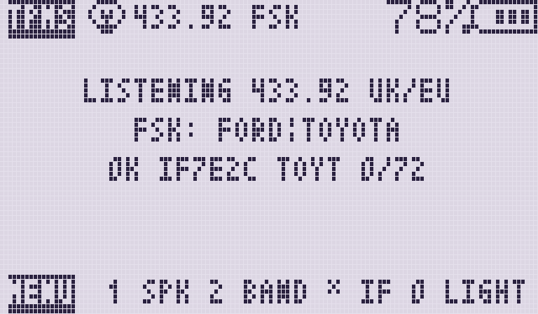
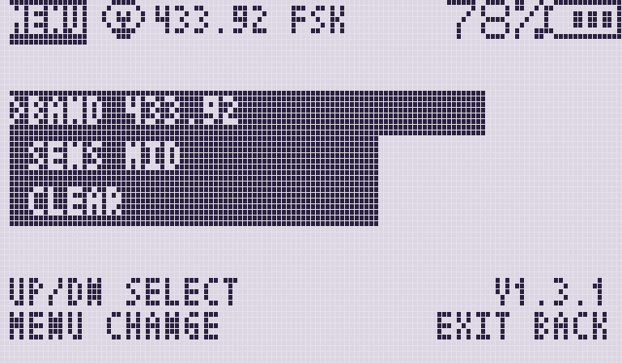
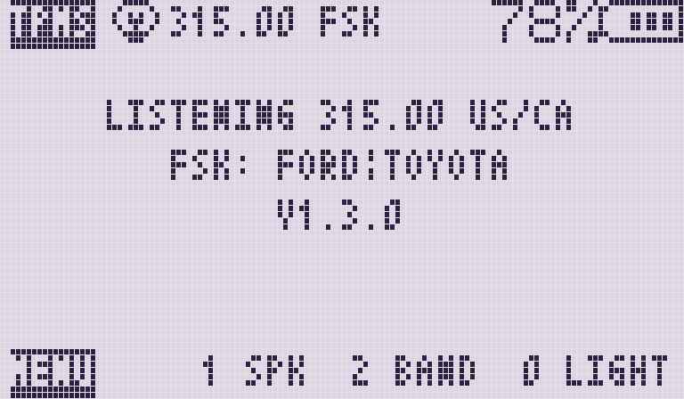
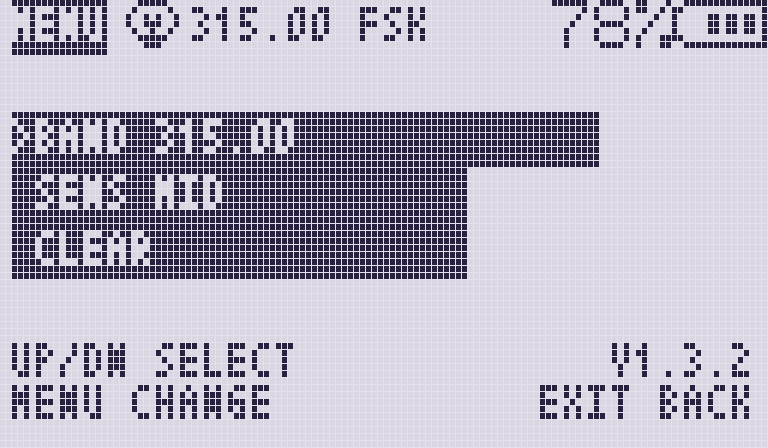
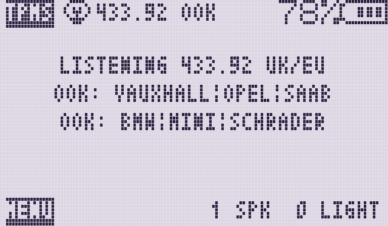
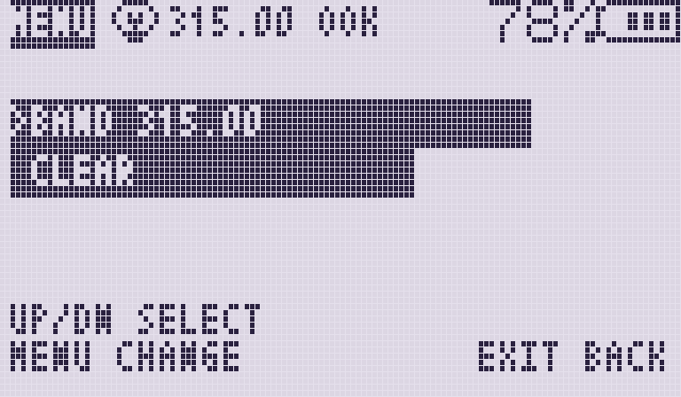

# Variant screens

The four list apps are built from the same `tpmsrx_app.c` with a flavour
flag. These LCD mocks show the waiting screen and the options menu for each
one. The status line shows the active **band** and **demod** (FSK or OOK),
and the car lines name the sensors that app decodes. `TPMS EU` and `TPMS NA`
show `BAND` and `CLEAR` in the menu; `TPMS EU2` and `TPMS NA2` have a fixed
band, so they show `CLEAR` only.

Regenerate with:

```sh
python3 tools/mock_lcd.py
```

## TPMS EU — UK / Europe, default 433.92 FSK

Ford and Toyota (FSK only). Band can be switched. Schrader MRXGG4 is in TPMS EU2.





## TPMS NA — US / Canada, default 315.00 FSK

Same sensors as EU; first launch parks on 315 MHz. Schrader MRXGG4 is in TPMS NA2.





## TPMS EU2 — UK / Europe, 433.92 OOK (fixed)

Schrader MRXGG4, Vauxhall / Opel / Saab (EG53) and BMW / Mini (MRXBC5A4). Band locked.




## TPMS NA2 — US / Canada, 315.00 OOK (fixed)

Schrader MRXGG4, Chevrolet / GM (EG53), Subaru / Nissan. Band locked.




## Shared gallery shots

Used from the main [README](../README.md) Screen section (EU examples):

| File | What it shows |
|---|---|
| [main_screen.png](main_screen.png) | Empty list / listening (EU) |
| [list.png](list.png) | Three sensors + free-row shortcuts (EU) |
| [menu.png](menu.png) | Options menu (EU) |
