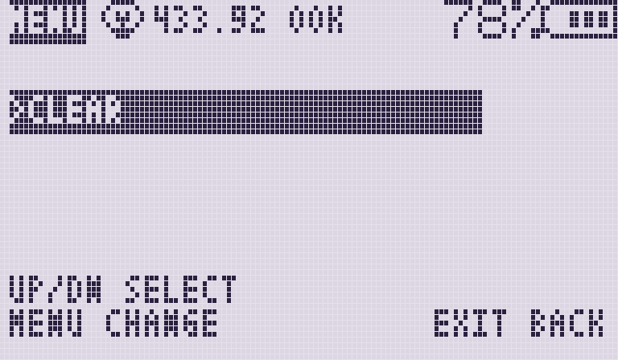
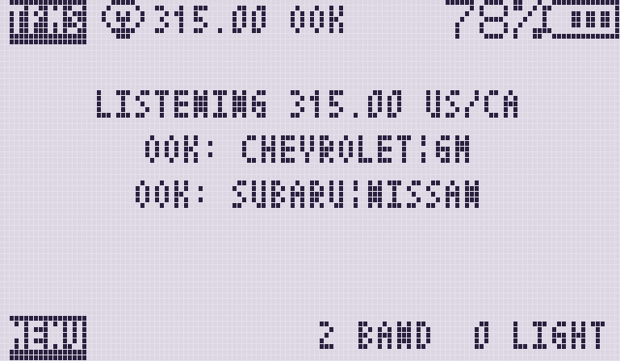
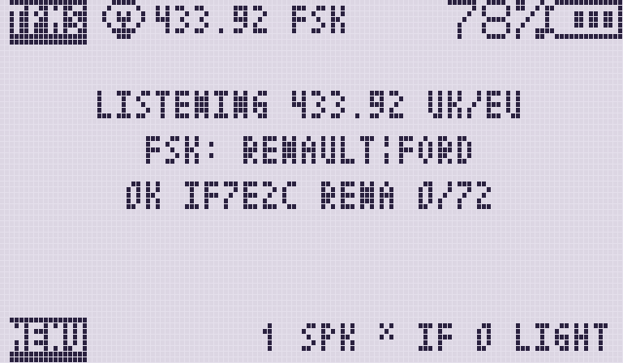
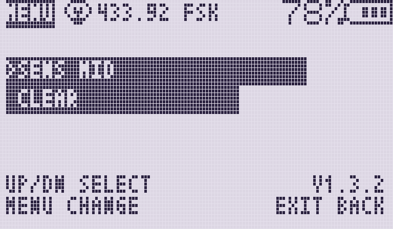

# Variant screens

The five list apps are built from the same `tpmsrx_app.c` with a flavour
flag. These LCD mocks show the waiting screen and the options menu for each
one. The status line shows the active **band** and **demod** (FSK or OOK),
and the car lines name the sensors that app decodes. `TPMS EU` and `TPMS NA`
show `BAND`, `SENS` and `CLEAR` in the menu; `TPMS EU2`, `TPMS NA2` and
`TPMS EU3` have a fixed band, so they show `SENS` and `CLEAR` only.

Regenerate with:

```sh
python3 tools/mock_lcd.py
```

## TPMS EU — UK / Europe, default 433.92 FSK

Ford and Toyota (FSK only). Band can be switched. Schrader MRXGG4 is in TPMS EU2.


## TPMS NA — US / Canada, default 315.00 FSK

Same sensors as EU; first launch parks on 315 MHz. Schrader MRXGG4 is in TPMS NA2.


## TPMS EU2 — UK / Europe, 433.92 OOK (fixed)

Schrader MRXGG4, Vauxhall / Opel / Saab (EG53) and BMW / Mini (older
Schrader sensor, MRXBC5A4). Band locked.




## TPMS NA2 — US / Canada, 315.00 OOK (fixed)

Schrader MRXGG4, Chevrolet / GM (EG53), Nissan / Infiniti and Subaru. Band
locked. Subaru shows as `NISS` on the Nissan scale, so it reads about a
quarter high.




## TPMS EU3 — UK / Europe, 433.92 FSK (fixed)

Renault (Clio, Captur, Zoe) and Ford. Band locked. The test line shows the
tuning offset, IF preset and the most bits one `AA A9` sync decoded, as
`RENA n/72`. Toyota stays in TPMS EU: both would not fit in one app.





## UV Studio listing text

Short descriptions for the [UV Studio Apps](https://armel.github.io/uvstudio/#apps)
listings, each 100 characters or fewer so it fits on the card. Update these
when a sensor moves between apps.

| App | Description |
|---|---|
| `TPMS EU` | TPMS RX (FSK) for UK & Europe, 433.92 MHz (can switch to 315). Decodes Ford and Toyota sensors. |
| `TPMS NA` | TPMS RX (FSK) for US & Canada, 315 MHz (can switch to 433.92). Decodes Ford and Toyota sensors. |
| `TPMS EU2` | TPMS RX (OOK) for UK & Europe, 433.92 MHz only. Schrader MRXGG4, Vauxhall/Opel/Saab, older BMW/Mini. |
| `TPMS NA2` | TPMS RX (OOK) for US & Canada, 315 MHz only. Schrader MRXGG4, Chevrolet/GM, Nissan/Infiniti, Subaru. |
| `TPMS EU3` | TPMS RX (FSK) for UK & Europe, 433.92 MHz only. Decodes Renault and Ford sensors. |
| `TPMS DBG` | TPMS signal debugger. Records raw FSK/OOK bursts to show why a TPMS app hears nothing. No decoding. |

## Shared gallery shots

Used from the main [README](../README.md) Screen section (EU examples):

| File | What it shows |
|---|---|
| [main_screen.png](main_screen.png) | Empty list / listening (EU) |
| [list.png](list.png) | Three sensors + free-row shortcuts (EU) |
| [menu.png](menu.png) | Options menu (EU) |
