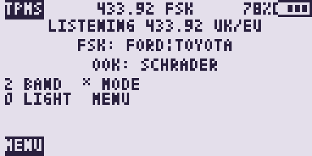
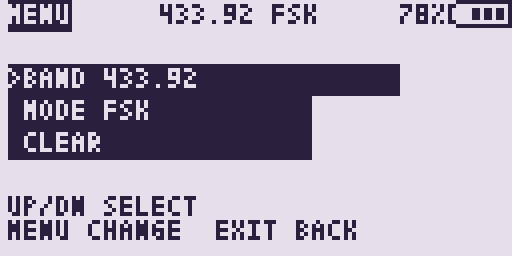
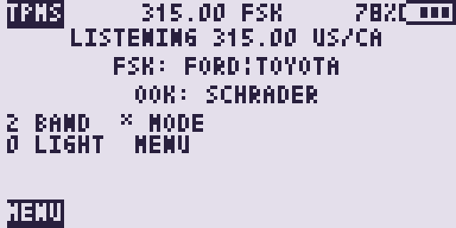
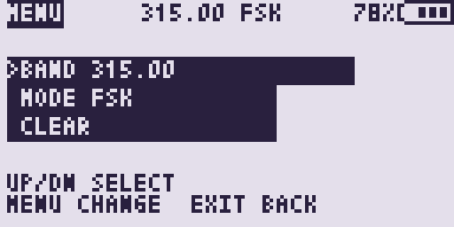
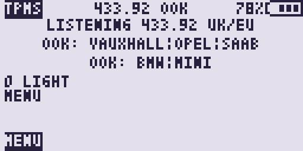
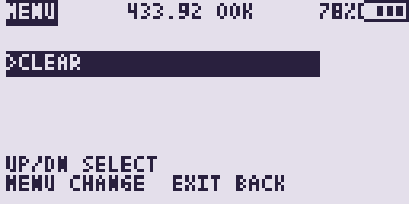
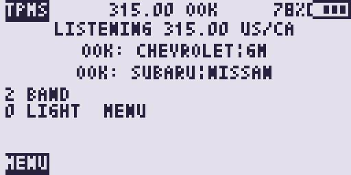
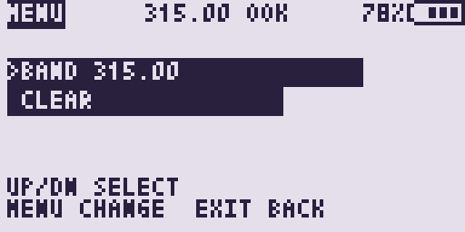

# Variant screens

All four apps are built from the same `tpmsrx_app.c` with a flavour flag.
These LCD mocks (`python3 tools/mock_lcd.py`) show the waiting screen and the
options menu for each variant. The status line carries the active **band** and
**protocol** (FSK or OOK); car lines name the sensors that flavour decodes.

Regenerate with:

```sh
python3 tools/mock_lcd.py
```

## TPMS EU — UK / Europe, default 433.92 FSK

Ford and Toyota (FSK), Schrader MRXGG4 (OOK). Band and mode are changeable.





## TPMS NA — US / Canada, default 315.00 FSK

Same sensors as EU; first launch parks on 315 MHz.





## TPMS EU2 — UK / Europe, 433.92 OOK (fixed)

Vauxhall / Opel / Saab (EG53) and BMW / Mini (MRXBC5A4). Band and mode locked.





## TPMS NA2 — US / Canada, default 315.00 OOK (mode fixed)

Chevrolet / GM (EG53), Subaru / Nissan. Mode locked to OOK; band still toggles.





## Shared gallery shots

Used from the main [README](../README.md) Screen section (EU examples):

| File | What it shows |
|---|---|
| [main_screen.png](main_screen.png) | Empty list / listening (EU) |
| [list.png](list.png) | Three sensors + free-row shortcuts (EU) |
| [menu.png](menu.png) | Options menu (EU) |
